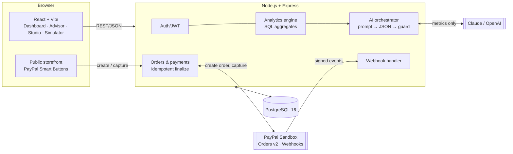

# BizPilot AI: your autonomous business growth partner

> **Don't just manage your business. Know exactly what to do next.**

BizPilot AI is built for small businesses (a bakery, clothing shop, salon, gift shop) that have sales data but no marketing or data analyst. It closes the whole growth loop:

**Understand → Decide → Create → Sell → Measure → Improve**

1. **Understand** – real metrics (revenue, gross profit, margins, product trends, stock, repeat customers) are calculated in SQL from the owner's own sales.
2. **Decide** – an AI advisor reads *only those computed metrics* and proposes measurable actions. Every number it shows as evidence is re-computed by the server, so the model cannot invent figures.
3. **Create** – with one click the owner turns a recommendation into a campaign: social post, hashtags and email, written by AI and editable by the owner.
4. **Sell** – the owner approves and launches. Customers buy from a public storefront through **PayPal Checkout (Orders v2)** in the PayPal Sandbox.
5. **Measure** – a verified PayPal payment (browser capture *and* signed webhook, idempotent) writes the sale, updates stock and refreshes the dashboard. The campaign's real before/during results are shown.
6. **Improve** – the AI analyses the new data and recommends the next action.

Plus a **Growth Simulator** ("what if I take 10% off my best seller?") showing margin, break-even units and profit scenarios, clearly labelled hypothetical.

Built for the [PayPal AI Hackathon](https://paypalaihackathon.devpost.com/).

---

## How PayPal and AI are used

| | What it does here |
|---|---|
| **PayPal Orders v2 API** | Server creates the order with server-side prices (never client prices), captures after buyer approval, uses `PayPal-Request-Id` idempotency keys. |
| **PayPal JS SDK (Smart Buttons)** | Storefront checkout; the browser only sends product ids and quantities. |
| **PayPal Webhooks** | Signature verified through `/v1/notifications/verify-webhook-signature`; events stored by `event_id` (unique) so duplicates are ignored; handles `PAYMENT.CAPTURE.COMPLETED / DENIED / REFUNDED / REVERSED`. |
| **Claude (Anthropic API)** or OpenAI | Structured-JSON business analysis, marketing copy, plain-language simulation explanations. Provider is configurable. |
| **Guardrails** | Product ids must exist, discounts are clamped to a margin-safe cap, evidence is replaced with server-computed facts, the owner approves before anything goes live, every AI call is logged (`ai_runs`). |
| **Rule-engine fallback** | With no API key (or if the LLM fails) a deterministic engine returns the same schema, so the product always works and the demo never breaks. |

## Architecture



More detail: [docs/ARCHITECTURE.md](docs/ARCHITECTURE.md) · Database: [docs/DATABASE.md](docs/DATABASE.md)

## Quick start

### Option A: Docker (one command)

```bash
cp .env.example .env        # optional: add PayPal sandbox + AI keys
docker compose up --build
```

Open **http://localhost:5173**. Create your own account, or sign in with the demo account `demo@bizpilot.ai` / `Demo@1234` (Sweet Crumbs Bakery with 90 days of sales, in rupees).
Customer storefront: **http://localhost:5173/shop/sweet-crumbs**

### Option B: run locally

Requirements: Node 20+ and PostgreSQL 14+ (16 recommended).

```bash
createdb bizpilot            # or use any empty database
cp .env.example backend/.env # edit DATABASE_URL and optional keys

cd backend && npm install
npm run db:migrate           # create tables (re-run after updates: it only applies new migrations)
npm run db:seed              # demo bakery + 90 days of sales
npm run dev                  # API on :4000

cd ../frontend && npm install
npm run dev                  # app on :5173 (proxies /api to :4000)
```

`npm run db:reset` drops everything and re-creates schema and demo data (development only).

## Rupees (₹) and PayPal

The app is built for Indian shops: every price, cost, expense and report is shown in **rupees** with lakh/crore grouping (₹1,23,456).
PayPal itself **cannot charge INR**, so at checkout the storefront shows the rupee total and PayPal charges the USD equivalent at `PAYPAL_FX_RATE` (rupees per dollar, default 88; set the current rate in `.env`). The customer sees the conversion before paying; the dashboard always records the rupee amount.

## Adaptive dashboard

The time ranges on the dashboard depend on how long the user has been using BizPilot:

| Using BizPilot for | Ranges offered | Charts by |
|---|---|---|
| under 1 week | 6H, 12H, 24H, 48H, 72H | hour |
| 1 week to 1 month | 1D, 1W, 2W, 3W... All time | hour (1D), day |
| 1 month to 1 year | 1D, 1W, 1M, 2M, 3M, 6M, 9M... | hour, day, week, month |
| 1 year or more | 1D, 1W, 1M, 3M, 6M, 1Y, 2Y... | up to monthly |

"Using BizPilot" is measured from the earlier of account creation and the first sale, so a shop that imports old sales gets the longer ranges straight away. A **Stock movement** chart shows units sold per hour/day/week/month by product, next to a **Stock levels** table with days of stock left.

## Accounts, sign-up and forgot password

* **Sign up:** username, email, contact number and password. Right after, a short screen asks for the business name and type.
* **Sign in:** email and password.
* **Forgot password:** enter your email → a single-use link (valid 30 minutes) is sent. With no mail server configured (`SMTP_*` in `.env`), the link is printed in the backend terminal and shown on the page **in development only**, so you can test the whole flow locally. In production, set the `SMTP_*` variables.

## Enabling real PayPal Sandbox payments

1. Go to <https://developer.paypal.com/dashboard/applications/sandbox> → **Create App** (Merchant type). Copy the **Client ID** and **Secret** into `.env` (`PAYPAL_CLIENT_ID`, `PAYPAL_CLIENT_SECRET`).
2. Restart the backend. `/api/health` will report `"paypal":"sandbox"`. (Without keys the app runs in `mock` mode and fakes payments so you can still explore the UI.)
3. **Webhook** (so payments are confirmed even if the browser closes): expose your API publicly (Render, or `ngrok http 4000`), then in the app's *Webhooks* section add `https://<your-host>/api/webhooks/paypal` and subscribe to `PAYMENT.CAPTURE.COMPLETED`, `PAYMENT.CAPTURE.DENIED`, `PAYMENT.CAPTURE.REFUNDED`, `PAYMENT.CAPTURE.REVERSED`. Copy the **Webhook ID** into `PAYPAL_WEBHOOK_ID`.
4. Buy from the storefront using a **sandbox personal account** (Dashboard → Testing tools → Sandbox accounts). Never use real credentials.

## Enabling the AI

Set `ANTHROPIC_API_KEY` (default model `claude-sonnet-5-5`, change with `ANTHROPIC_MODEL`) or `OPENAI_API_KEY`. With neither, the AI Advisor uses the built-in rule engine and says so in the UI.

## Demo walkthrough (about 3 minutes)

1. **Dashboard**: revenue, profit and product trends. Custom cakes are down ~58%, bread is up.
2. **AI Advisor → Analyse**: recommendations with verified evidence (cake decline, cheesecake nearly out of stock, bread momentum).
3. **Approve & create campaign**: AI writes the post and email. Edit, then **Approve & launch**.
4. **Storefront**: the discounted product appears. Pay with a PayPal sandbox buyer.
5. **Dashboard**: the new order is already in the numbers; stock dropped.
6. **Growth Simulator**: "10% off the Celebration Cake" → break-even and scenarios.
7. **Campaign results**: before/during comparison. (The seeded Cinnamon Roll campaign shows an honest result: more units, but less profit.)

A suggested video script is in [docs/SUBMISSION.md](docs/SUBMISSION.md).

## Project structure

```
database/        migrations/001_init · 002_auth_phone_reset_onboarding · 003_inr_and_checkout_fx · seed.sql · tests/constraints.sql · sample-sales.csv
backend/src/
  routes/        auth, catalog (products, expenses), sales (+CSV), insights (analytics, AI, simulator),
                 campaigns, public (storefront + checkout), webhooks
  services/      analytics (SQL) · metrics · insights (rule engine) · ai + llm + guard
                 simulator · paypal · orders (idempotent payment finalisation) · sales
  db/            pool, migrate runner     middleware/   auth, errors
backend/test/    unit tests (node:test)
frontend/src/    pages (Dashboard, Advisor, Campaigns, Simulator, Products, Sales, Storefront, auth)
docs/            ARCHITECTURE · DATABASE · SUBMISSION
docker-compose.yml · render.yaml
```

## API overview

| Area | Endpoints |
|---|---|
| Auth | `POST /api/auth/register`, `POST /api/auth/login`, `POST /api/auth/forgot-password`, `POST /api/auth/reset-password`, `GET /api/auth/me` |
| Business | `PATCH /api/business` (name, type, onboarding) |
| Catalog | `GET/POST /api/products`, `PUT/DELETE /api/products/:id`, `GET/POST/DELETE /api/expenses` |
| Sales | `GET/POST /api/sales`, `POST /api/import/csv` |
| Analytics | `GET /api/analytics/overview?hours=720` (omit `hours` for the default range; response includes the ranges for this user) |
| AI | `POST /api/ai/analyze`, `GET /api/ai/recommendations`, `PATCH /api/ai/recommendations/:id` |
| Simulator | `POST /api/simulator` |
| Campaigns | `GET/POST /api/campaigns`, `PATCH /api/campaigns/:id`, `POST …/launch`, `POST …/end`, `GET …/performance` |
| Public | `GET /api/public/config`, `GET /api/public/shop/:slug`, `POST /api/public/shop/:slug/orders`, `POST /api/public/orders/:orderId/capture` |
| Webhook | `POST /api/webhooks/paypal` |

## Security notes

- Passwords hashed with bcrypt (8+ chars, letters and numbers); JWT sessions; reset tokens are random, single-use, expire in 30 minutes and only their hash is stored; "forgot password" never reveals whether an email exists; all owner endpoints are scoped to the owner's `business_id`.
- Composite foreign keys make cross-business data leaks impossible at the database level.
- Prices and discounts are decided on the server; PayPal credentials never reach the browser (only the public client id).
- Captured amount must equal the sale total or the sale is marked failed.
- Webhook signatures are verified; duplicate events are ignored.
- Rate limiting on auth, public and AI routes; `helmet` headers; input validated with `zod`.
- Sandbox only. `PAYPAL_MODE=mock` is refused in production.

## Tests

```bash
cd backend && npm test                                         # simulator, metrics, rule engine, AI guard (no DB needed)
psql "$DATABASE_URL" -f database/tests/constraints.sql         # 17 negative tests: the database must reject bad data
```

## Roadmap

Competitor intelligence · AI-generated posters · campaign scheduling · customer segmentation · demand forecasting · richer agentic commerce.

## License

[MIT](LICENSE)

