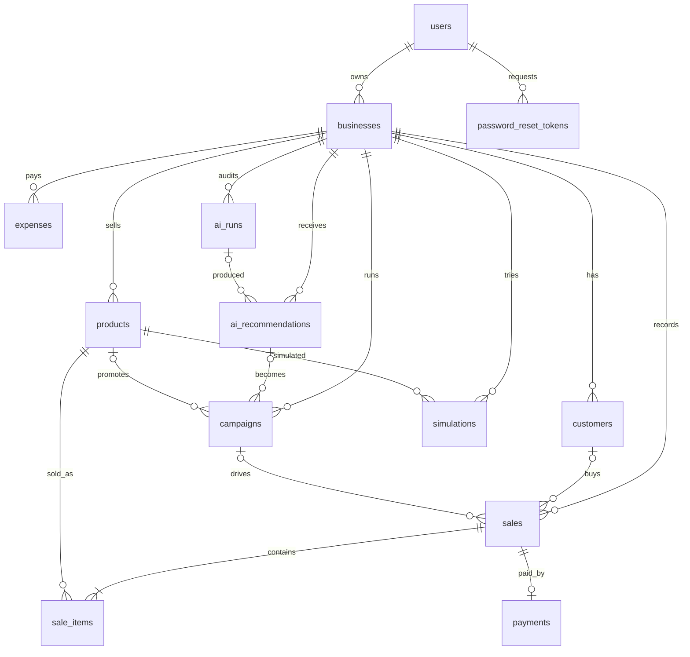

# Database design (PostgreSQL 16)

Schema: [`database/migrations/`](../database/migrations/001_init.sql) · demo data: [`database/seed.sql`](../database/seed.sql) · negative tests: [`database/tests/constraints.sql`](../database/tests/constraints.sql)

## Principles

| Rule | How it is enforced |
|---|---|
| Money is never floating point | every amount is `NUMERIC(12,2)`; JS maths is done in integer cents |
| One business can never touch another's data | every tenant table has `business_id`; links between tables use **composite foreign keys** `(id, business_id)` |
| History does not change when a product is edited | `sale_items` snapshots `product_name`, `list_price`, `unit_price`, `unit_cost` |
| Totals cannot be inconsistent | `CHECK (total = subtotal - discount_total)`, `CHECK (unit_price <= list_price)` |
| Payments are idempotent | unique `paypal_order_id`, unique `paypal_capture_id`, one payment per sale, unique webhook `event_id` |
| Sales with history are never lost | `sale_items.product_id` is `ON DELETE RESTRICT` (the API archives instead) |
| Invalid states are impossible | `CHECK` constraints on every status/category column, discounts 0 to 90 %, stock ≥ 0 |
| Analytics only count real money | views read **only `status = 'paid'`** sales, so pending, failed and refunded orders drop out automatically |

## Entity relationship diagram



## Tables (14 + migration log)

| Table | Purpose | Notable columns / rules |
|---|---|---|
| `users` | owner accounts | unique `lower(email)`, email format check, bcrypt hash, **`phone`** (digits with optional `+`, 7 to 15 long, unique when present) |
| `password_reset_tokens` | forgot-password links | stores only the **SHA-256 hash** of the token, `expires_at` (30 min), `used_at` (single use), unique hash |
| `businesses` | a shop | `slug` (public storefront URL), `category` enum, `currency` (default **INR**), **`onboarded`** (FALSE right after sign-up until the owner names the business) |
| `products` | catalogue | `price`, `cost`, `stock ≥ 0`, `low_stock_threshold`, `active`; unique name and SKU per business |
| `customers` | buyers | optional email, unique per business (case-insensitive) |
| `sales` | one order | `status` pending/paid/failed/refunded/cancelled, `source` manual/csv/paypal, `campaign_id` attribution |
| `sale_items` | order lines | price/cost snapshots, `quantity > 0` |
| `payments` | PayPal data | order id, capture id, payer, raw response JSONB, status; **`amount`/`currency` = what PayPal charged (USD)**, **`fx_rate`** = rupees per dollar used, while `sales.total` stays in rupees |
| `paypal_webhook_events` | webhook audit and dedup | unique `event_id`, `signature_valid`, `processed_at`, `processing_error` |
| `expenses` | running costs | category enum, `amount > 0`; feeds net profit |
| `ai_runs` | audit of every AI call | provider, model, **input metrics shown to the model**, output, `fallback_used`, latency |
| `ai_recommendations` | the advisor's proposals | problem, `evidence` JSONB, action, `success_metric`, `status` proposed → approved / rejected / completed |
| `campaigns` | marketing | AI-generated copy, `discount_pct`, status draft/active/ended/cancelled, date window |
| `simulations` | what-if results | baseline units/profit, break-even, scenario JSON, narrative |
| `schema_migrations` | created by the migrate runner | applied migration names |

## Views

* **`v_sale_item_facts`**: one row per sold line on *paid* sales with `revenue`, `cost`, `gross_profit`. Every dashboard figure derives from it.
* **`v_daily_metrics`**: orders, units, revenue and gross profit per day per business (feeds the chart).

## Indexes

`sales (business_id, sold_at DESC)` and `(business_id, status, sold_at DESC)` for time-window analytics · `sale_items (business_id, product_id)` for product trends · `sales (campaign_id)` partial · `ai_recommendations (business_id, status, created_at DESC)` · unique partial indexes for PayPal ids, SKU and customer email.

## How a PayPal payment flows through the tables

```
POST /public/shop/:slug/orders      sales(pending) + sale_items + payments(created, paypal_order_id)
buyer approves in PayPal popup
POST /public/orders/:id/capture  ─┐
PAYMENT.CAPTURE.COMPLETED webhook ─┴→ finalizePayment():  BEGIN
                                        SELECT … FOR UPDATE   (payments + sales)
                                        already paid?  → return (idempotent)
                                        amount ≠ total? → payments/sales = failed
                                        payments = completed (+ capture id, payer)
                                        sales    = paid, sold_at = now()
                                        products.stock -= quantity
                                      COMMIT
```

The browser capture and the webhook can arrive in either order, or twice, and the sale is still recorded exactly once.

## Demo data

`seed.sql` (re-runnable; amounts are in rupees) creates `demo@bizpilot.ai` / `Demo@1234`, *Sweet Crumbs Bakery* (`/shop/sweet-crumbs`), 8 products, 45 customers, about 2,150 paid sales over 90 days, 13 expense rows and one finished campaign (Sourdough Loaf ₹250, Custom Celebration Cake ₹1,800, rent ₹45,000 a month and so on):

| Product | Trend (built in so the AI has something real to find) |
|---|---|
| Sourdough Loaf, Baguette | growing |
| Custom Celebration Cake | declining (high margin, so it matters) |
| Cheesecake Slice | declining and nearly out of stock |
| Cinnamon Roll | had a 20 %-off campaign 45 to 52 days ago, with measurable before/during results |

## Useful queries

```sql
-- revenue and profit, last 30 days vs previous 30
SELECT sum(revenue) FILTER (WHERE sold_at >= now() - interval '30 days') AS cur,
       sum(revenue) FILTER (WHERE sold_at <  now() - interval '30 days') AS prev
FROM v_sale_item_facts
WHERE business_id = 1 AND sold_at >= now() - interval '60 days';

-- best sellers by profit
SELECT product_name, sum(gross_profit) AS profit
FROM v_sale_item_facts WHERE business_id = 1 GROUP BY 1 ORDER BY 2 DESC;

-- which AI provider answered, and did the rule engine have to step in?
SELECT kind, provider, model, fallback_used, latency_ms, created_at FROM ai_runs ORDER BY id DESC LIMIT 10;
```

## Rupees and PayPal

All shop data (prices, costs, sales, expenses) is stored in the shop's currency, **INR** by default (`businesses.currency`, `sales.currency`).
PayPal cannot charge Indian rupees ([PayPal currency list](https://developer.paypal.com/api/nvp-soap/currency-codes/)), so at checkout the customer sees rupee prices and PayPal charges the USD equivalent:

```
sales.total       = 1810.00 INR      (what the dashboard counts)
payments.amount   =   20.57 USD      (what PayPal charged)   payments.fx_rate = 88
```
The captured USD amount must equal `payments.amount`, otherwise the sale is marked failed. Migration `003` sets the INR defaults and adds `payments.fx_rate` (must be > 0).

## Dashboard time buckets

Charts are built in SQL with `generate_series` + `date_trunc(<hour|day|week|month>, sold_at AT TIME ZONE 'Asia/Kolkata')`, so quiet hours or days appear as zero. The bucket size follows the selected range (up to 72 h: hourly, up to 31 days: daily, up to ~200 days: weekly, longer: monthly). The ranges offered depend on the user's tenure (earlier of account creation and first paid sale): under 1 week hourly ranges; 1 week to 1 month 1D/1W/2W...; months 1D/1W/1M...; years 1D/1W/1M/1Y...

## Auth flow and the database

```
sign up    users(+phone) + businesses(onboarded = FALSE)  →  onboarding screen names the business, sets onboarded = TRUE
forgot     old tokens marked used → INSERT sha256(token), expires in 30 min → link emailed (or printed in dev)
reset      SELECT … WHERE hash = $1 AND used_at IS NULL AND expires_at > now() FOR UPDATE → new bcrypt hash, token marked used
```
The raw token never touches the database, so a leaked database cannot be used to reset passwords.

## Migrations

Plain SQL files in `database/migrations/` applied in filename order by `backend/src/db/migrate.js` and tracked in `schema_migrations`. `001_init.sql` is the core schema; `002_auth_phone_reset_onboarding.sql` adds phone numbers, password resets and onboarding; `003_inr_and_checkout_fx.sql` switches the defaults to INR and records the PayPal conversion rate. To change the schema, add `004_*.sql`; never edit an applied migration.
